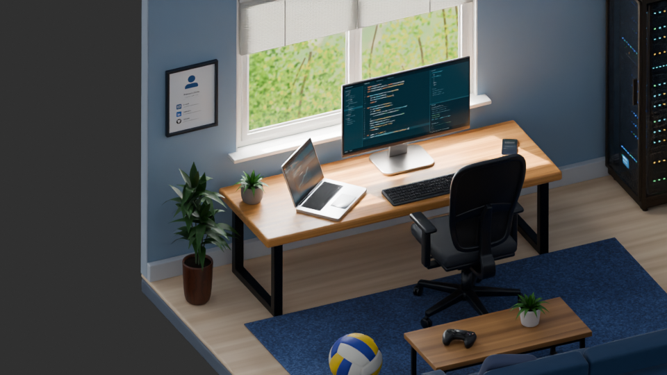
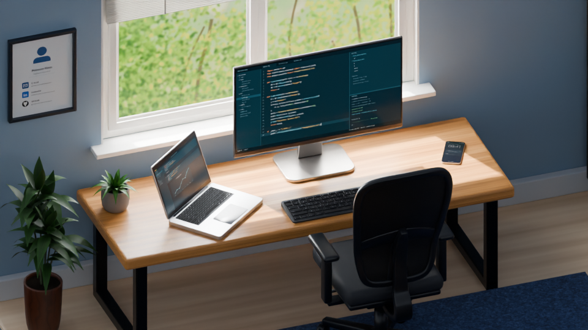
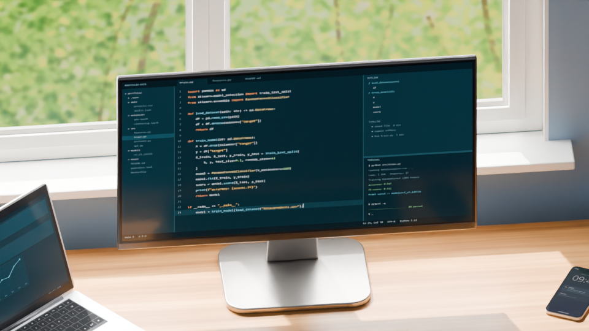
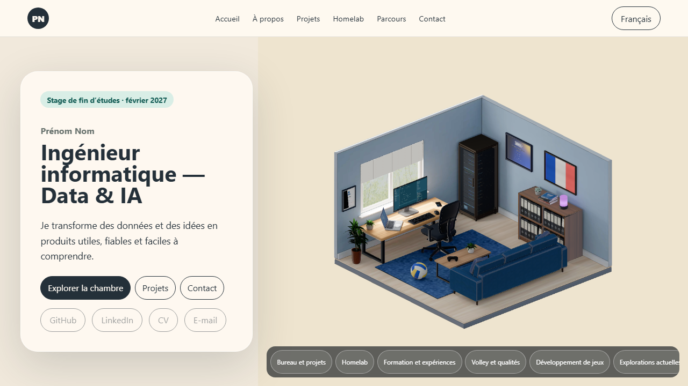
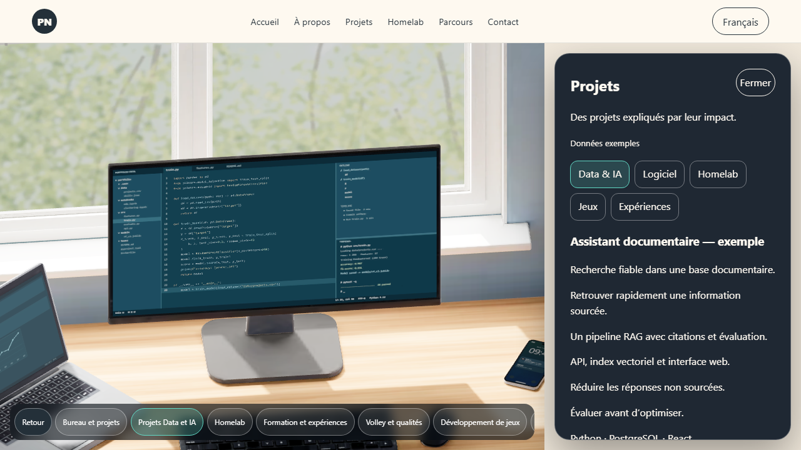
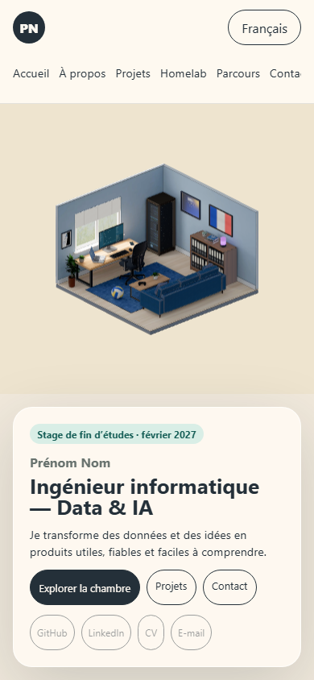
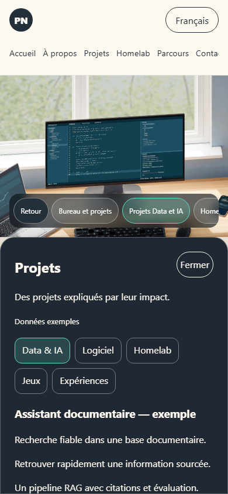
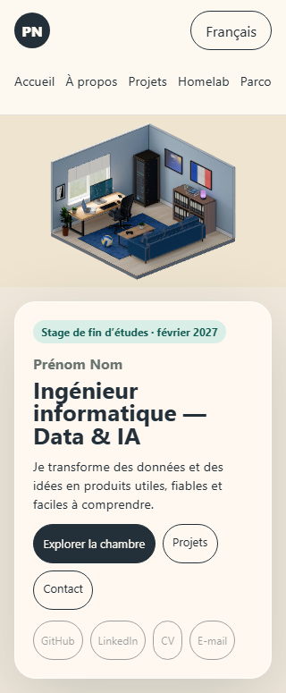

# Étude des cadrages et prototype de navigation

Cette étude conserve les captures et la validation du premier prototype. La [refonte éditoriale et la personnalisation](interface-redesign.md) décrivent la version actuelle, avec les repères sur les objets, le menu repliable, le réglage manuel des mouvements et la lecture rapide.

Date : 17 octobre 2026. Source confirmée : `assets/blender/portfolio-room.blend`, Blender 5.1.2. Les rendus d’étude proviennent d’un processus Blender distinct qui ne sauvegarde pas la scène. Le modèle, le mobilier, les matériaux et les repères exportés sont conservés.

## Décisions spatiales

La vue orthographique reste adaptée à la composition semi-ouverte. Elle conserve la lecture du bureau à gauche, du homelab dans l’angle et du salon au premier plan. La réduction de la carte d’accueil donne davantage de place à la pièce sur ordinateur. Les panneaux disposent de leur propre espace pour que le modèle ne soit pas masqué par le texte.

Le premier trajet finalisé suit `CAM_Overview → CAM_Anchor_Desk → CAM_Anchor_Monitor`. Il donne un bref contexte au bureau, passe au-dessus du fauteuil puis se stabilise face à l’écran. Le menu et le clic sur l’écran déclenchent tout ce trajet en une seule action. La durée totale est de 1,1 seconde ; les segments disposent d’au moins 220 ms pour éviter une arrivée trop brusque sur le dernier repère.



À 50 % du temps, le fauteuil reste au premier plan, mais la caméra se trouve sur le segment d’approche dégagé.



À 80 %, le contexte du bureau est encore présent ; le dernier segment prépare le gros plan de l’écran.



Le cadrage final conserve les indices du bureau sans demander de lire le portfolio dans une texture. Les projets sont présentés dans un panneau HTML séparé.

## Contrôle des passages

Le [plan de dessus](../../assets/reviews/camera-navigation-plan.svg) représente les volumes principaux et les repères. La hauteur figure près de chaque repère ; un croisement en projection 2D ne signifie donc pas une collision 3D. La caméra générale est hors du plan, son entrée est schématisée.

| Trajet | Résultat du contrôle |
| --- | --- |
| Vue générale → téléphone directement | Rejeté : intersection avec `Chair_Back_Frame` et `Chair_Back_Mesh`. |
| Vue générale → bureau → téléphone | Aucun volume élargi intersecté sur les deux segments. |
| Vue générale → bureau → écran | Aucun volume élargi intersecté sur les deux segments. |
| Vue générale → six autres destinations principales et bureau | Aucun volume élargi intersecté sur les segments retenus. |

Le [rapport](../../assets/reviews/camera-path-review.json) couvre neuf destinations et utilise les 305 boîtes englobantes des maillages de la scène de référence, à l’état jour. Il teste exactement chaque segment contre ces boîtes élargies de 0,12 unité de scène. L’approche est conservatrice pour le centre de caméra ; elle ne prouve pas l’absence de mobilier dans les bords du cadre ni l’absence d’occlusion d’un contenu. Les objets texte et les états animés intermédiaires ne sont pas couverts par ce contrôle.

Le runtime emprunte les arêtes de ces chemins dans les deux sens. En cas de nouvelle sélection pendant un mouvement, il continue l’arête si elle appartient au nouveau chemin ou revient au dernier repère atteint, puis rejoint la nouvelle destination. Il ne trace pas de raccourci arbitraire à travers les meubles.

## Comportement du prototype

- `ROOM` : cadrage général, parallaxe limitée et objets sélectionnables.
- `FOCUS` : trajet fini et interruptible ; le déplacement du pointeur ne pilote plus la caméra et les clics de scène sont suspendus. Le menu HTML peut changer la destination et Échap permet le retour.
- `INTERACT` : panneau HTML ouvert après l’arrivée ; titre focalisé au clavier. Les destinations de contexte comme le bureau restent sans panneau.

Une fin de trajet porte son identifiant de sélection. Le reducer ignore un identifiant annulé, ce qui empêche un ancien panneau de s’ouvrir après une nouvelle sélection. Le retour utilise l’historique de navigation ; un accès direct aux projets revient à la vue générale. Les mouvements réduits appliquent le cadrage final sans déplacement animé. Un échec du GLB ouvre immédiatement les contenus HTML, sans attendre un événement caméra impossible.

## Captures du navigateur

Les images suivantes sont des captures du GLB rendu dans Chromium, distinctes des rendus Blender ci-dessus. Les contenus portent encore la mention « Données exemples ».









L’accueil est aussi vérifié à 320 × 568 : la chambre et la carte se suivent dans le flux de la page. Les petits écrans peuvent défiler pour lire toute la carte, sans masquer la pièce derrière celle-ci.



## Vérifications effectuées

- `npm test` : 21 fichiers, 98 tests réussis.
- `npm run test:e2e` : six scénarios Chromium réussis, couvrant chargement, parallaxe, objets, thème/langue, clavier, historique, secours, mobile et mouvements réduits.
- Le scénario de cadrage a ensuite été relancé après le dernier ajustement de l’accueil mobile : réussi en 1280 × 720, 390 × 844 et 320 × 568 ; les captures ci-dessus correspondent à cette dernière exécution.
- `npm run build` : réussi. Vite signale encore la taille du module principal, environ 1,24 Mo avant gzip ; le découpage du chargement sera à mesurer lors de l’optimisation.
- `npm run assets:check` : réussi, 308 nœuds nommés.
- Contrôle géométrique : neuf routes réussies avec la marge décrite plus haut.
- Formatage : les fichiers modifiés et les nouveaux fichiers de code passent le contrôle ciblé. Le contrôle global du dépôt échoue sur 38 fichiers non modifiés, dont le workflow CI, des configurations et des sources existantes ; aucun de ces avertissements ne concerne les fichiers modifiés ici.

Le navigateur automatisé emploie un rendu logiciel : les tests valident les comportements et les cadrages, pas un objectif de FPS sur matériel réel.

## Reproduire l’étude

Après une modification de géométrie ou de repères, regénérer le snapshot depuis le master. Le script n’enregistre pas le fichier Blender :

```powershell
& 'C:\Program Files\Blender Foundation\Blender 5.1\blender.exe' --background assets/blender/portfolio-room.blend --python scripts/snapshot-room-cameras.py
node scripts/review-camera-paths.mjs
& 'C:\Program Files\Blender Foundation\Blender 5.1\blender.exe' --background assets/blender/portfolio-room.blend --python scripts/render-camera-study.py
```

Utiliser le Node 24 déclaré par le projet pour le script de contrôle, qui importe le fichier TypeScript des chemins. Les durées et le graphe des repères restent définis dans `src/room/cameraPaths.ts`. Le contrôle géométrique produit aussi le plan de dessus ; les rendus intermédiaires reprennent ses chemins et ses durées.

Pour le comportement de `Canvas`, le fallback reste un contenu visuel statique ; la détection d’erreur et l’ouverture du contenu de secours passent par la gestion d’erreur existante. Le déplacement utilise `useFrame` sans mise à jour React à chaque image ; seule l’arrivée est transmise au reducer. [Canvas R3F](https://r3f.docs.pmnd.rs/api/canvas), [recommandations de performance R3F](https://r3f.docs.pmnd.rs/advanced/pitfalls).

## Suite de la conception

Les prochaines étapes sont la personnalisation des contenus, la mise en scène spécifique de chaque destination et les essais sur matériel réel. Le prototype ne comprend pas encore la rotation par glisser, un réglage manuel des mouvements, le son ou des surprises supplémentaires. Les préférences système de réduction des mouvements sont prises en compte.
