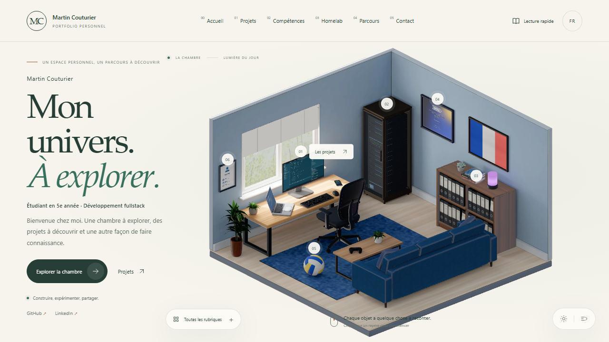
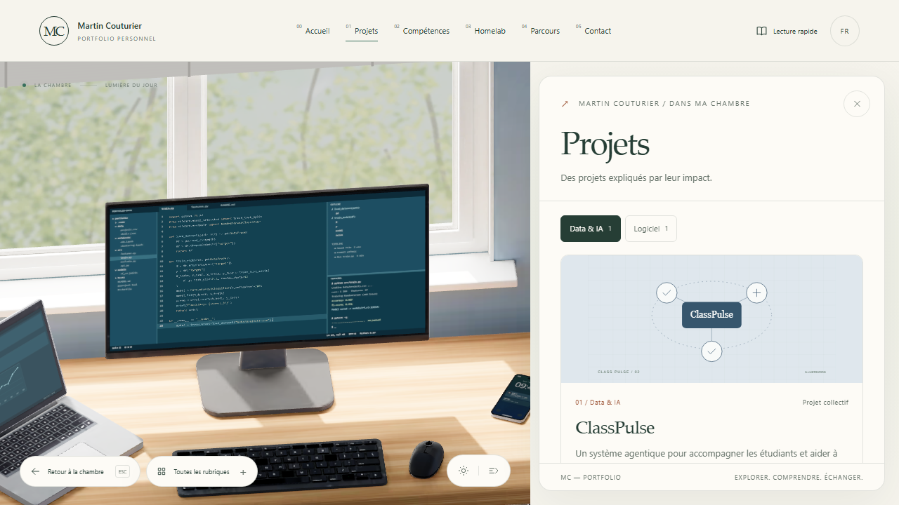
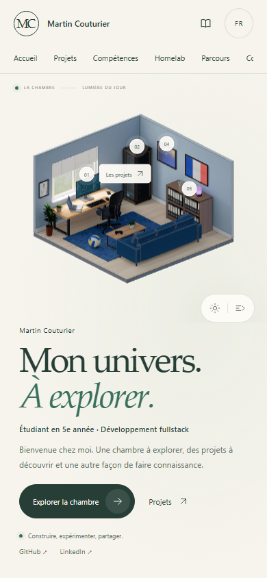
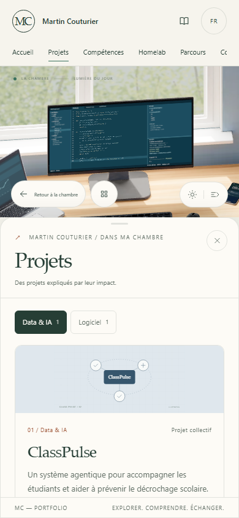
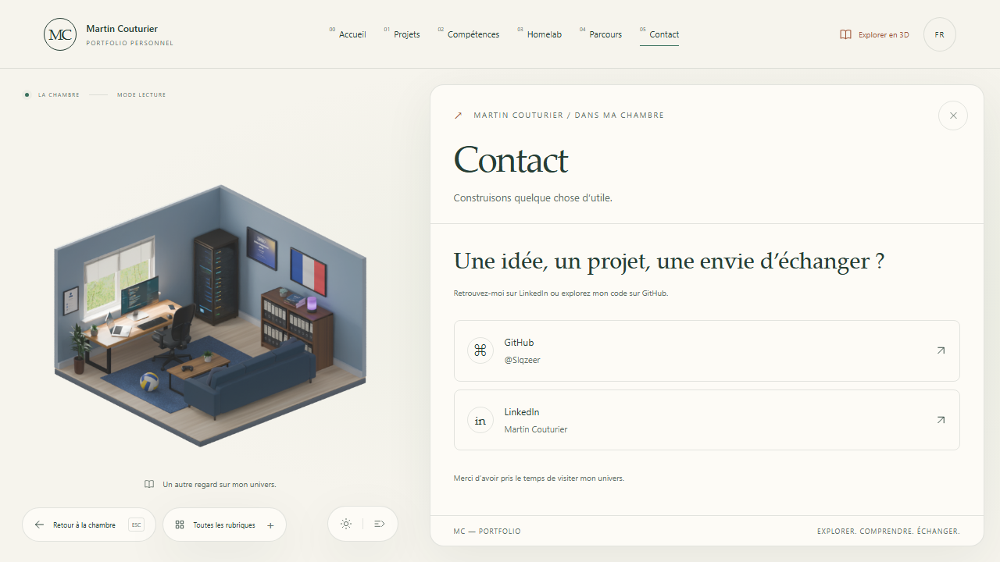
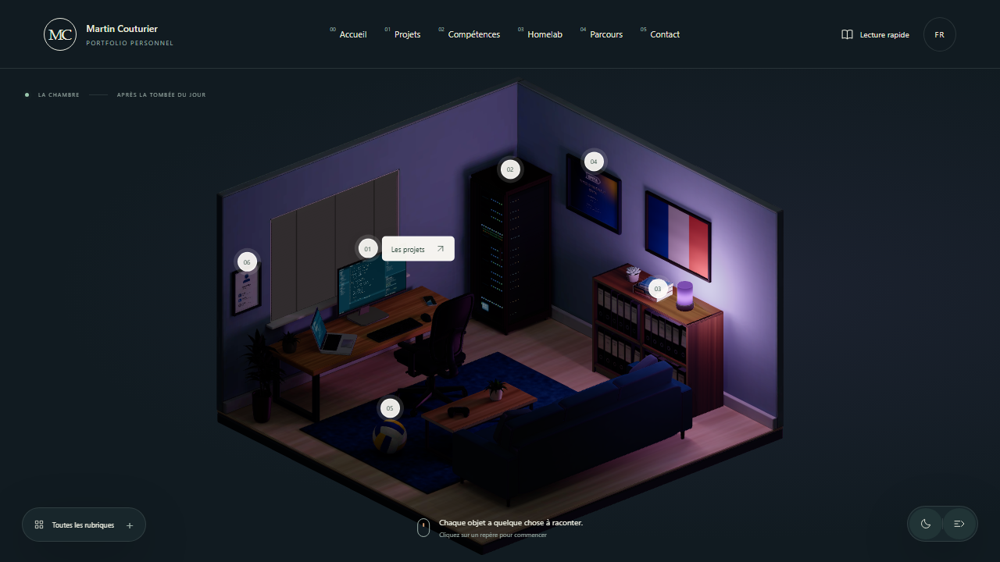

# Refonte de l’interface — Martin Couturier

19 octobre 2026 — Les fiches entrent désormais pendant l’approche de la caméra : glissement depuis la droite sur ordinateur, depuis le bas sur mobile. La chambre se redimensionne progressivement et conserve davantage de place (panneau de 34 vw sur ordinateur, 54 dvh sur mobile ; la lecture rapide garde son espace dédié). La fermeture conserve temporairement le contenu pour permettre le mouvement de sortie, avec une fiche immédiatement retirée de la navigation clavier et des lecteurs d’écran. Le focus du titre attend l’arrivée de la caméra, ne fait pas défiler la page et respecte un contrôle déjà activé dans la fiche. Les repères ont un halo discret, décalé entre les objets et suspendu avec les animations de la chambre. Le titre d’accueil est plafonné à 52 px pour éviter une coupure supplémentaire sur grand écran.

La référence [Bruno Simon](https://bruno-simon.com/) utilise actuellement des [modales en fondu](https://github.com/brunosimon/folio-2025/blob/main/sources/style/modals.styl). Le panneau latéral conserve ici la relation entre objet et contenu. Cette évolution remplace la règle d’ouverture uniquement à l’arrivée décrite dans le plan d’expérience antérieur. Aucun nouveau moteur d’animation n’est ajouté.

Les nouveaux scénarios Chromium mesurent plusieurs positions du panneau pendant l’approche, l’espace laissé à la chambre et la fermeture aux formats 1440 × 900 et 390 × 844. Le scénario de pause vérifie aussi que la transition est supprimée lorsque les animations sont désactivées.

[Fiche sur ordinateur](../../assets/reviews/portfolio-flow-projects-desktop.png) · [Fiche sur mobile](../../assets/reviews/portfolio-flow-projects-mobile.png)

18 octobre 2026 — Mise à jour : la barre pleine largeur et les commandes réparties aux quatre coins sont remplacées par une barre compacte centrée. **Explorer** rassemble les destinations, **Réglages** rassemble les préférences et la lecture rapide. Les légendes et bulles permanentes autour de la scène sont supprimées ; le texte d’accueil est réduit et le cadrage garde la chambre entière visible sur ordinateur. Les animations démarrent actives, même si le système demande des mouvements réduits ; seule une pause explicitement enregistrée par le visiteur est restaurée. La lecture et les onglets masqués suspendent toujours les mouvements. Les paragraphes suivants décrivent la refonte du 17 octobre.

17 octobre 2026. Cette version remplace l’habillage du premier prototype et personnalise les contenus à partir des informations fournies par Martin. La chambre existante reste la source visuelle : les géométries, le GLB et les fichiers Blender éditables sont conservés.

## Composition et lecture

L’accueil adopte un fond ivoire, une palette vert profond / terre cuite et des titres en caractères à empattements. La chambre occupe davantage de place ; le texte de présentation se lit directement dans la page. Le cadrage s’agrandit dans une colonne étroite, tout en préservant la marge verticale du cadrage Blender dans une fenêtre large.

Six repères HTML sont placés à partir des objets réels du GLB : projets, homelab, compétences, parcours, volley et contact. Ils restent accessibles au clavier. La navigation principale et le menu repliable offrent les mêmes destinations. Le retour restaure le contrôle d’origine, y compris quand un repère est recréé après le mouvement de caméra ou qu’une commande a été retirée puis réinsérée lors d’un changement de contexte.

Les fiches disposent d’un en-tête fixe et d’une zone de lecture défilante. Les projets présentent une illustration signalée comme telle, une synthèse, la stack, les liens et un récit dépliable. Les catégories sans projet sont masquées dans la sélection principale ; une destination encore vide propose de revenir aux projets publiés.

Le mode **Lecture rapide** démonte la scène WebGL et affiche immédiatement les mêmes fiches HTML. Il fonctionne pendant le chargement du modèle. Les posters de lecture et de secours ont été recalculés depuis le master Blender avec un fond transparent, sans enregistrer de modification de scène. Le module 3D est chargé séparément de l’interface.

Le réglage manuel des mouvements est conservé dans le navigateur. La préférence système reste prioritaire, y compris lorsqu’elle change pendant que l’onglet est masqué. Les mouvements ambiants se mettent aussi en pause quand la page n’est plus visible.

## Contenus

- Martin Couturier, étudiant en cinquième année ; liens GitHub et LinkedIn fournis.
- ClassPulse : système agentique d’aide aux étudiants visant à prévenir le décrochage scolaire, backend Python / FastAPI. Contribution : conception, tests, vérification du backend et qualité du produit. Aucun résultat chiffré ou déploiement n’est affirmé.
- Portfolio : présentation de la chambre interactive et des choix techniques réellement présents dans le dépôt.
- Parcours : cinquième année, expérience fullstack chez CACIB, contribution à ClassPulse. Aucune date ni diplôme obtenu n’est inventé.
- La configuration du homelab, les dates du parcours, le nom exact de l’établissement et les coordonnées complémentaires restent à préciser. Le CV et l’e-mail sont masqués tant qu’aucune destination n’est fournie. Le dépôt ClassPulse n’était pas accessible publiquement lors de la vérification ; sa description vient directement de Martin.

## Captures et validation

Les captures `portfolio-redesign-*` de `assets/reviews/` montrent le GLB réellement rendu dans Chromium et l’interface, aux formats 1280 × 720, 390 × 844 et 320 × 568. Les images `portfolio-prototype-*` conservent l’état précédent pour comparaison.

Les vérifications portent sur le chargement et son échec, les repères, les trajets, les retours clavier et l’historique, le thème, la langue, la lecture sans attendre le GLB, les préférences de mouvement et les dispositions mobiles. Le contrôle géométrique des neuf trajets est conservé. Il valide le centre de la caméra contre les volumes des objets avec une marge de 0,12, sans prétendre garantir tous les cadrages intermédiaires.

Le rendu logiciel du navigateur automatisé ne mesure pas les performances sur un ordinateur ou un téléphone physique. Vite signale encore la taille du module 3D ; l’interface et la scène sont désormais dans deux fichiers distincts. Le contrôle de formatage global comporte des avertissements préexistants hors des fichiers modifiés ; le contrôle ciblé est celui de cette refonte.

Résultats : `npm test` — 101 tests réussis dans 21 fichiers ; `npm run test:e2e` — huit scénarios réussis. Build, contrôle des 308 nœuds du GLB, neuf routes géométriques, formatage ciblé et `git diff --check` réussis. Après le dernier build, les quatre scénarios concernés par les derniers ajustements ont de nouveau réussi, y compris le menu mobile ouvert au-dessus d’une fiche, la lecture sans attendre le modèle, les repères et les captures sur trois formats d’écran.

L’interface représente environ 258,5 Ko de JavaScript avant gzip (81,7 Ko compressés) ; le module 3D séparé environ 1 010,8 Ko (272,6 Ko compressés). Ce découpage rend l’interface indépendante du chargement du moteur, sans prétendre réduire le poids total du moteur 3D.

